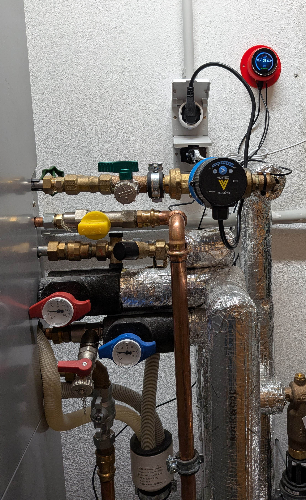

Maker Media GmbH

***

# Warmduscher-Gedächtnis

### Eine lernfähige Steuerung macht die Zirkulationspumpe intelligent: Sie läuft nur dann, wenn wirklich jemand Warmwasser braucht.

Zwei Temperaturfühler außen am Rohr erkennen jede Warmwasser-Entnahme. Ein Controller mit ESP32-S3 und rundem Touchdisplay lernt daraus den Wochenrhythmus des Haushalts und schaltet die Pumpe über eine WLAN-Steckdose mit ESPHome-Firmware.

Den vollständigen Artikel mit der Bauanleitung gibt es in der [Make-Ausgabe 7/26 ab Seite 64](https://www.heise.de/select/make/2026/7). Hier finden Sie die ESPHome-Firmware samt External Component, die Gerber-, Bohr- und Stücklistendaten der Interface-Platine (`pcb/`), die Druckdateien für das Gehäuse (`mechanics/`), einen Browser-Simulator (`docs/`), die Home-Assistant-Anbindung sowie im Ordner `nous_a1t/` die ESPHome-Firmware für die WLAN-Steckdose Nous A1T. Die ausführliche Dokumentation des Autors steht in [README_Autor.md](README_Autor.md).

Die Dateien stammen aus den Repositories des Autors Dirk Eichel, [STB3/esphome-hotcirc](https://github.com/STB3/esphome-hotcirc) und [STB3/esphome-NousA1T](https://github.com/STB3/esphome-NousA1T). Dort gibt es auch künftige Updates. Die fertig bestückte Interface-Platine verkauft der Autor über [Lectronz](https://lectronz.com/products/hotcirc-smart-hot-water-circulation-controller).

Lizenzen: Software unter GPL-3.0-or-later, Hardware-Daten, Bilder und Dokumentation unter CC BY-NC-SA 4.0 (siehe [LICENSE](LICENSE)), Steckdosen-Firmware unter MIT-Lizenz (siehe [nous_a1t/LICENSE](nous_a1t/LICENSE)).
